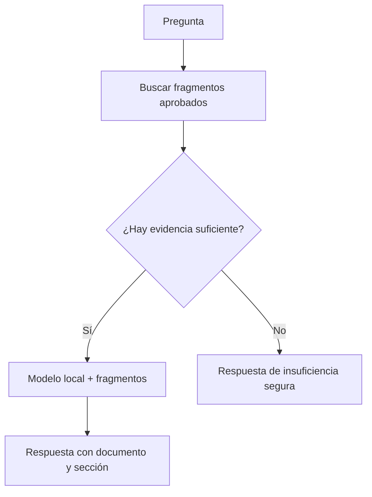

# BioVic IA

## Estado actual

BioVic incluye el motor determinístico `EquipmentRuleEngine` y una consulta contextual por equipo conectable a Ollama o a un proveedor compatible mediante `.env`. El RAG documental con citas y aprobación de fuentes continúa pendiente.

## Principios obligatorios

- IA asistencial y de solo lectura.
- Nunca ejecuta SQL libre ni recibe credenciales de base de datos.
- No crea, modifica, elimina, aprueba ni certifica equipos.
- Las alertas objetivas se calculan por reglas antes de consultar un modelo.
- Una respuesta sobre uso, alarmas o procedimientos requiere fuentes autorizadas.
- Si no hay evidencia suficiente, BioVic debe indicarlo y no inventar.

Mensaje permanente previsto:

> Las recomendaciones de BioVic IA son orientativas y no reemplazan las indicaciones del fabricante, los procedimientos institucionales ni la evaluación de personal biomédico competente.

## Proveedor local

Configuración propuesta:

```env
BIOVIC_AI_ENABLED=true
BIOVIC_AI_PROVIDER=ollama
BIOVIC_AI_BASE_URL=http://localhost:11434
BIOVIC_AI_MODEL=qwen3:8b
BIOVIC_AI_API_KEY=
```

## Herramientas permitidas

La futura capa de IA solo podrá invocar funciones controladas de lectura: `GetEquipment`, `SearchEquipment`, `GetMaintenanceHistory`, `GetCalibrationHistory`, `GetAuditHistory`, `GetEquipmentDocuments`, `GetEquipmentAlerts` y `GetEquipmentStatistics`.

## RAG local



Solo manuales, fichas técnicas, procedimientos y guías marcados como aprobados se indexarán. Se conservarán documento, versión, hash, página/sección y fecha de indexación.
