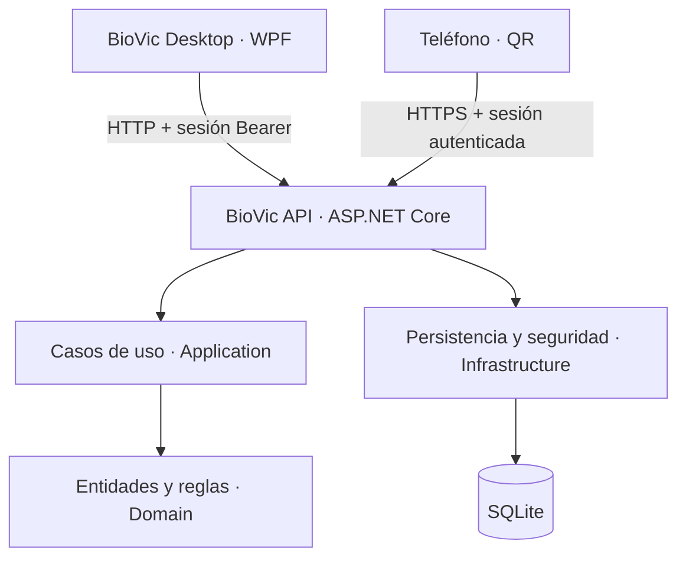
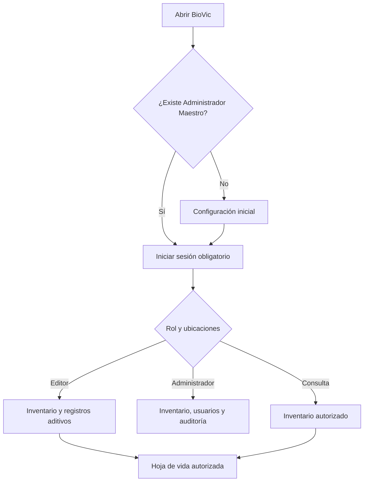
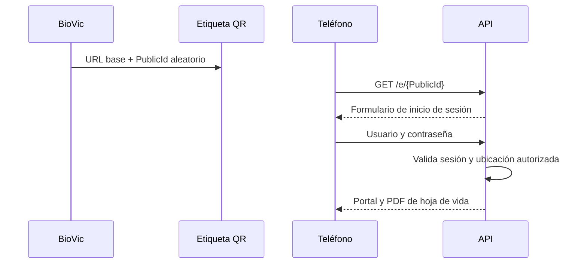

# Arquitectura de BioVic

## Objetivos

La arquitectura prioriza trazabilidad, integridad, seguridad y una evolución sin rediseño desde un solo computador a una instalación multi-PC.

## Proyectos

| Proyecto | Responsabilidad |
|---|---|
| `BioVic.Domain` | Entidades, enumeraciones e invariantes básicas sin dependencia de UI o base de datos. |
| `BioVic.Application` | Contratos, DTO, casos de uso puros, búsqueda aproximada, reglas y hash canónico. |
| `BioVic.Infrastructure` | EF Core, SQLite, migraciones, autenticación, sesiones, auditoría y servicios. |
| `BioVic.Api` | Endpoints, autorización por políticas, contexto de solicitud, manejo de errores y logs. |
| `BioVic.Desktop` | Cliente Windows WPF siguiendo MVVM; consume exclusivamente la API. |
| `BioVic.QrPortal` | Inicio de sesión y renderizado web responsive de la hoja de vida autorizada. |
| `BioVic.Tests` | Pruebas automatizadas de lógica crítica. |

## Flujo de navegación

## Casos de uso del MVP

1. Detectar primer inicio y crear el único Administrador Maestro.
2. Autenticar un usuario y emitir una sesión opaca con expiración.
3. Crear usuarios Editor o Consulta desde la API administrativa.
4. Crear y consultar ubicaciones estructuradas.
5. Crear equipos con validación de código y, de forma configurable, serial único.
6. Buscar equipos con coincidencia exacta, parcial y aproximada.
7. Abrir la hoja de vida y registrar cada consulta.
8. Agregar mantenimiento sin sobrescribir el historial.
9. Cambiar estado creando un registro histórico.
10. Consultar un equipo por `PublicId` desde el portal QR.
11. Consultar el dashboard y verificar la cadena de auditoría.

## Flujo QR

La IP o dominio nunca se guarda en código. `BIOVIC_QR_BASE_URL` se configura por ambiente. El teléfono debe alcanzar el servidor por LAN o por una publicación controlada con HTTPS. El `PublicId` identifica el equipo, pero no concede acceso: siempre se requiere una sesión válida y permiso sobre su ubicación.

## Estrategia de auditoría

Las operaciones relevantes generan un `AuditLog`. Cada registro incorpora el hash del anterior. La serialización canónica excluye contraseñas, tokens y claves de IA. La escritura de la cadena se serializa dentro del proceso; el cambio de negocio y su auditoría se guardan juntos en el mismo `SaveChanges` transaccional.

## Evolución multi-PC

En modo local, API, base de datos y escritorio pueden convivir en un PC. En modo institucional, la API y la base se publican en un servidor y cada cliente cambia únicamente `BIOVIC_API_URL`. Para SQL Server/PostgreSQL se crea un proveedor de infraestructura y migraciones propias, manteniendo los contratos de Application.

## Perfil de producción centralizada

En producción, el cliente WPF y el portal QR llegan al mismo dominio mediante HTTPS. IIS termina TLS y reenvía hacia Kestrel en el mismo servidor. `BIOVIC_API_URLS` permanece en `127.0.0.1`; no se abre el puerto 5180 a Internet. El cliente Windows obtiene el dominio desde `biovic.client.json` sin incluir secretos.

El piloto usa una sola instancia de API y SQLite con WAL y copias verificadas. PostgreSQL requiere migraciones y conciliación de datos específicas y se habilitará como un incremento posterior, no mediante un cambio directo de cadena de conexión.

## Dependencias

- .NET 10 / C# 14.
- WPF con `net10.0-windows`.
- ASP.NET Core 10.
- Entity Framework Core 10.0.11.
- Proveedor oficial EF Core SQLite 10.0.11.
- xUnit 2.9.3 y Microsoft.NET.Test.Sdk 18.9.0.

No hay dependencia obligatoria de Internet para el inventario. Las dependencias NuGet solo son necesarias al compilar.
