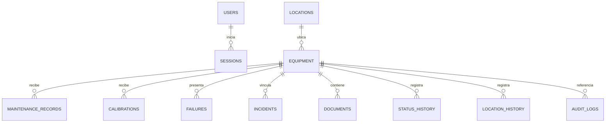

# Modelo de base de datos

## Diagrama relacional principal



## Tablas

| Tabla | Propósito |
|---|---|
| `Users` | Identidad, hash de contraseña, rol, estado, intentos y bloqueo. |
| `Sessions` | Hash SHA-256 del token, expiración y revocación. Nunca almacena el token utilizable. |
| `Locations` | Institución, sede, edificio, piso, servicio, área, habitación y ubicación específica. |
| `Equipment` | Hoja de vida principal: identificación, regulación, adquisición, responsable, datos técnicos, estado y criticidad. |
| `MaintenanceRecords` | Registros aditivos de mantenimiento y próximo mantenimiento. |
| `Calibrations` | Historial de calibración y trazabilidad metrológica. |
| `Failures` | Reportes de falla, impacto, diagnóstico, solución y tiempo de indisponibilidad. |
| `TechnoVigilanceIncidents` | Incidentes y estado de investigación/reporte. |
| `EquipmentDocuments` | Metadatos, ruta relativa, versión y hash SHA-256 de documentos. |
| `EquipmentStatusHistory` | Antes, después, fecha, motivo y usuario. |
| `EquipmentLocationHistory` | Origen, destino, motivo, entrega, recepción y usuario. |
| `EquipmentResponsibleHistory` | Historial de responsables. |
| `RegulatoryRequirements` | Catálogo actualizable de normas y referencias. |
| `AuditLogs` | Registro inmutable de actividad con hash encadenado. |

## Llaves e índices

- Las entidades usan `Guid` para evitar dependencia de autoincrementos al migrar de proveedor.
- `Equipment.PublicId` es único, aleatorio y diferente de la llave interna.
- `Equipment.InternalCode` es único.
- El serial tiene índice; su unicidad se valida según `BIOVIC_SERIAL_MUST_BE_UNIQUE`.
- `Users.NormalizedUsername` es único.
- Un índice único filtrado impide un segundo `MasterAdministrator`.
- Búsqueda e indicadores usan índices de nombre, serial, modelo, fabricante, estado, texto normalizado y fechas de mantenimiento.
- `AuditLogs.Id` es un entero autoincremental exclusivamente para conservar el orden de la cadena.

## Fechas y zonas horarias

La aplicación usa `DateTimeOffset` en el dominio y normaliza a UTC. SQLite almacena ticks UTC (`INTEGER`) mediante convertidores, lo que permite ordenar y comparar sin depender de texto. `TimestampLocal` en auditoría conserva una representación legible de Colombia.

## Borrado lógico

Equipos, usuarios, ubicaciones, documentos y requisitos regulatorios incorporan `IsDeleted`, `DeletedAtUtc`, `DeletedByUserId` y `DeletionReason`. Los filtros globales excluyen registros dados de baja sin destruirlos.

## Migraciones

La migración inicial está en `src/BioVic.Infrastructure/Data/Migrations/202608180001_InitialCore.cs` y se aplica automáticamente al iniciar la API.

Para crear una migración posterior:

```powershell
dotnet ef migrations add NombreCambio `
  --project src/BioVic.Infrastructure `
  --startup-project src/BioVic.Api `
  --output-dir Data/Migrations
```

BioVic usa la API de backup de SQLite sin copiar directamente un archivo WAL activo. Cada copia ejecuta `PRAGMA integrity_check`; una copia incompleta se elimina y el error queda en el registro técnico. El intervalo, ruta y retención se configuran con `BIOVIC_BACKUP_*`.

Para el piloto centralizado debe ejecutarse una sola instancia de `BioVic.Api`. Los clientes WPF y los celulares acceden exclusivamente por HTTPS; nunca se comparte el archivo `.db`.

PostgreSQL será un incremento independiente después de definir el servidor. No se habilita el proveedor hasta disponer de migraciones específicas y una conciliación documentada de datos, permisos, identificadores QR y auditoría.
