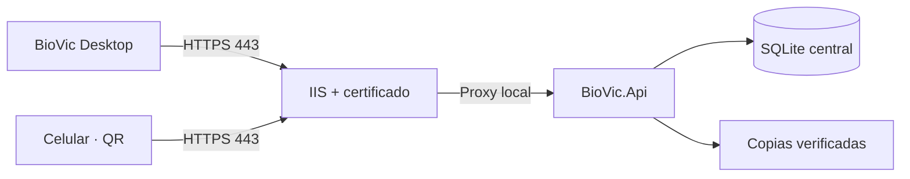

# BioVic · Etapa 1 de preparación para producción

## Resultado

La interfaz WPF permanece visualmente intacta. Los cambios se concentran en configuración, seguridad del portal QR, publicación detrás de IIS, copias verificadas y conexión de los clientes Windows con una API central.

En esta etapa se conserva SQLite para el piloto con una condición estricta: debe existir **una sola instancia de BioVic.Api** con acceso al archivo. Ningún computador cliente abre la base directamente.



## Requisitos

1. Windows Server actualizado.
2. IIS con enlace HTTPS y certificado válido.
3. .NET 10 Hosting Bundle estable.
4. Dominio o subdominio, por ejemplo `biovic.institucion.org`.
5. Carpetas fuera del directorio publicado:

   ```text
   D:\BioVicData\data
   D:\BioVicData\backups
   D:\BioVicData\logs
   ```

6. Permisos de lectura y escritura únicamente para la identidad del grupo de aplicaciones de BioVic y los administradores autorizados.

## 1. Verificar y publicar

Desde la raíz del proyecto:

```powershell
powershell -ExecutionPolicy Bypass -File .\scripts\verify-stage1.ps1
dotnet restore BioVic.sln
powershell -ExecutionPolicy Bypass -File .\scripts\publish-server-windows.ps1
```

El resultado se crea en `artifacts\server-win-x64`. No incluye `.env`, base de datos, claves, registros ni copias.

El proyecto exige un SDK estable de .NET 10. Si `dotnet --version` muestra una versión preliminar, instale el SDK estable antes de publicar.

## 2. Configurar el servidor

Copie `.env.production.example` como `.env` dentro de la carpeta publicada y reemplace como mínimo:

```env
BIOVIC_API_URL=https://biovic.institucion.org
BIOVIC_QR_BASE_URL=https://biovic.institucion.org/e
BIOVIC_ALLOWED_HOSTS=biovic.institucion.org
BIOVIC_DB_CONNECTION=Data Source=D:\BioVicData\data\biovic.db
BIOVIC_BACKUP_PATH=D:\BioVicData\backups
BIOVIC_LOG_PATH=D:\BioVicData\logs
```

Mantenga:

```env
BIOVIC_ENVIRONMENT=Production
BIOVIC_API_URLS=http://127.0.0.1:5180
BIOVIC_REQUIRE_HTTPS=true
BIOVIC_REVERSE_PROXY_ENABLED=true
BIOVIC_DB_PROVIDER=sqlite
BIOVIC_BACKUP_ENABLED=true
```

BioVic rechaza el arranque si detecta HTTP público, un host global `*`, Kestrel expuesto en `0.0.0.0`, copias deshabilitadas o una URL QR que no sea HTTPS.

## 3. Administrador Maestro inicial

Si se migra la base actual y ya contiene el Administrador Maestro:

```env
BIOVIC_SETUP_ENABLED=false
```

Para una base vacía:

1. Genere un token temporal:

   ```powershell
   [Convert]::ToHexString([Security.Cryptography.RandomNumberGenerator]::GetBytes(32))
   ```

2. Configure temporalmente en el servidor:

   ```env
   BIOVIC_SETUP_ENABLED=true
   BIOVIC_SETUP_TOKEN=TOKEN_GENERADO
   ```

3. En el computador administrativo, establezca el mismo token solo durante la creación:

   ```powershell
   $env:BIOVIC_SETUP_TOKEN="TOKEN_GENERADO"
   ```

4. Cree el Administrador Maestro desde BioVic Desktop.
5. Cambie `BIOVIC_SETUP_ENABLED=false`, borre el token y reinicie el sitio.

## 4. Configurar IIS

1. Instale el Hosting Bundle estable de .NET 10.
2. Cree un grupo de aplicaciones exclusivo para BioVic con **No Managed Code**.
3. Cree el sitio apuntando a la carpeta publicada.
4. Configure el enlace HTTPS en el puerto 443 con el certificado del dominio.
5. No publique el puerto 5180 en el firewall ni en el router.
6. Conceda a `IIS AppPool\BioVic` lectura sobre la aplicación y lectura/escritura únicamente sobre `D:\BioVicData`.
7. Restrinja `.env` para que solo administradores y la identidad del sitio puedan leerlo.

El archivo `web.config` se genera con `dotnet publish`. IIS administra el proceso de ASP.NET Core y comunica las solicitudes a Kestrel dentro del mismo servidor.

## 5. Configurar los clientes Windows

En la carpeta de BioVic Desktop, copie `biovic.client.example.json` como `biovic.client.json` y configure:

```json
{
  "apiUrl": "https://biovic.institucion.org"
}
```

Este archivo no contiene contraseñas. `BIOVIC_API_URL` también puede utilizarse y tiene prioridad sobre el JSON.

## 6. Probar desde Internet

```powershell
powershell -ExecutionPolicy Bypass -File .\scripts\test-production-readiness.ps1 `
  -BaseUrl "https://biovic.institucion.org"
```

Después, desde un celular usando datos móviles:

1. Escanee un QR regenerado con el dominio definitivo.
2. Confirme que aparece el inicio de sesión.
3. Pruebe un usuario autorizado y otro sin permiso para esa ubicación.
4. Descargue el PDF.
5. Verifique la consulta y la descarga en la auditoría del Administrador Maestro.

## 7. Copias y recuperación

BioVic crea una copia mediante la API nativa de SQLite, ejecuta `PRAGMA integrity_check` y solo conserva archivos verificados. El intervalo y la retención se controlan con:

```env
BIOVIC_BACKUP_INTERVAL_HOURS=24
BIOVIC_BACKUP_RETENTION_DAYS=30
```

Una copia en el mismo servidor no es suficiente. Infraestructura debe replicar `D:\BioVicData\backups` a un destino institucional cifrado y probar restauraciones periódicas.

## Limitación deliberada

PostgreSQL no se activa únicamente cambiando una variable. Primero se debe elegir el servidor, crear migraciones específicas, convertir y transferir los datos y verificar equipos, usuarios, permisos, `PublicId` y la cadena de auditoría. Hasta completar esa prueba, BioVic detiene el arranque si se configura un proveedor distinto de SQLite.
